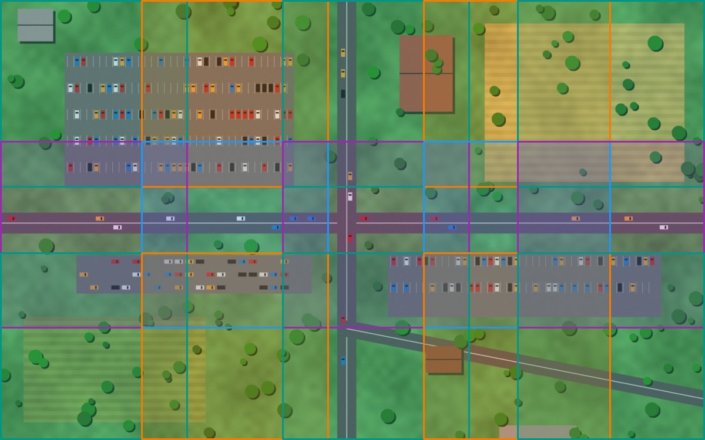

<p align="center">
  
</p>

<h1 align="center">plakakia</h1>

<p align="center"><em>πλακάκια: fast image tiling for computer vision datasets</em></p>

<p align="center">
  <a href="https://pypi.org/project/plakakia/"></a>
  <a href="https://pypi.org/project/plakakia/"></a>
  <a href="https://github.com/kalfasyan/plakakia/actions/workflows/ci.yml"></a>
  <a href="https://kalfasyan.github.io/plakakia"></a>
  <a href="https://github.com/astral-sh/ruff"></a>
  <a href="LICENSE"></a>
</p>

**plakakia** splits images, **hyperspectral cubes** and any N-D array into (overlapping)
tiles along the axes you choose, and carries their labels along: bounding boxes in **YOLO**,
**Pascal VOC** or **COCO** format, or **segmentation masks**. Satellite and drone
**GeoTIFFs** stay georeferenced, tile by tile. Use it to train and run models on large
images (aerial, satellite, microscopy, inspection) at full resolution.

<p align="center">
  
  <br><em>One 2400 × 1500 aerial image with 194 labelled cars, cut into 15 overlapping 640 × 640 tiles.
  New to tiling? <a href="https://kalfasyan.github.io/plakakia/concepts/">See how it works</a>, with pictures and a playground.</em>
</p>

- **Fast**: vectorised NumPy tiling and box assignment, plus a multiprocess pipeline.
- **Small**: four dependencies (`numpy`, `opencv-python-headless`, `pyyaml`, `tqdm`).
- **Any data**: grayscale, RGB(A), 16-bit, multispectral and hyperspectral cubes
  (`.npy`, HDF5, TIFF, GeoTIFF), channels-first or last, tiled along any axes.
- **Typed and tested**: strict mypy, full test suite on Linux, macOS and Windows.

## Installation

```bash
uv add plakakia        # or: pip install plakakia
```

Requires Python 3.10+.

## Quick start

### Tile an array (online)

```python
import cv2
from plakakia import tile_image

image = cv2.imread("scene.jpg")
tiles, coords = tile_image(image, tile_size=640, step_size=480, cover_edges=True)
# tiles:  (N, 640, 640, 3) array
# coords: (N, 4) array of (x1, y1, x2, y2), so tiles[i] == image[y1:y2, x1:x2]
```

With boxes:

```python
from plakakia import assign_boxes_to_tiles, clip_boxes_to_tile, read_yolo

ann = read_yolo("scene.txt", image_size=image.shape[:2])
assignment = assign_boxes_to_tiles(ann.boxes, coords, min_visibility=0.6)  # (tiles, boxes) bool

for t in range(len(tiles)):
    idx = assignment[t].nonzero()[0]
    boxes, labels = clip_boxes_to_tile(ann.boxes[idx], coords[t]), ann.labels[idx]
```

### Detect small objects on a large image

Run any detector tile by tile and get the boxes back on the full image, duplicates merged
and objects cut by tile borders put back together:

```python
from plakakia import predict_tiled

# model(tiles) -> one (boxes, scores, class_ids) per tile, in tile pixels
dets = predict_tiled(image, model, tile_size=640)
dets.boxes, dets.scores, dets.class_ids  # on the full image
```

Pass a GeoTIFF's profile and `dets.to_geojson()` gives polygons on the map. See the
[small object detection guide](https://kalfasyan.github.io/plakakia/small-objects/).

### Tile a dataset (offline)

```bash
plakakia --config config.yaml
```

```yaml
input_dir_images: data/images
input_dir_annotations: data/labels
input_format_annotations: yolo   # yolo | pascal_voc | coco | segmentation | none
output_format_annotations: yolo  # yolo | pascal_voc
tile_size: 640
step_size: 480
cover_edges: true
num_workers: -1                  # all cores
```

See [`examples/config.yaml`](examples/config.yaml) for every option and the
[CLI documentation](https://kalfasyan.github.io/plakakia/cli/) for details. Or use it from
Python:

```python
from plakakia import TilingConfig, run

results = run(TilingConfig.from_yaml("config.yaml"))
```

### Hyperspectral and satellite data

```python
import numpy as np
from plakakia import tile_array

cube = np.load("scene.npy", mmap_mode="r")  # (bands, H, W), read lazily
tiles, starts = tile_array(cube, (256, 256, 32), (192, 192, 16), axes=(1, 2, 0))
# tiles: (T, 32, 256, 256) spatial x spectral windows; starts: (y, x, band) per tile
```

```yaml
georeference: true          # each GeoTIFF tile keeps its CRS and its own transform
axes: [1, 2]                # rasterio arrays are (bands, height, width)
bands: [3, 2, 1, 7]         # pick bands before tiling
band_axis: 0
max_nodata_fraction: 0.5    # skip tiles that are mostly outside the swath
```

```bash
uv add "plakakia[hyperspectral,geo]"   # h5py + tifffile, rasterio
```

See the [hyperspectral & geospatial guide](https://kalfasyan.github.io/plakakia/remote-sensing/).

### Demo app

```bash
uv run --extra demo streamlit run demo/app.py
```


## Features

| | |
| --- | --- |
| Input data | JPEG/PNG/..., `.npy` (memory-mapped), HDF5, multi-band TIFF, GeoTIFF |
| Axes | any axes, per-axis tile size and stride, rectangular tiles |
| Geospatial | per-tile CRS and transform, nodata filtering, band selection |
| Input labels | YOLO (boxes and polygons), Pascal VOC, COCO, masks, or none |
| Output labels | YOLO, Pascal VOC, PNG mask tiles |
| Overlap | any `step_size` ≤ or > `tile_size` |
| Edge handling | `cover_edges` adds border-aligned tiles; `pad_image` pads first |
| Partial boxes | `min_visibility` keeps and clips partially visible boxes |
| Deduplication | `clear_duplicates` keeps the fewest tiles that still contain every box |
| Background tiles | `save_empty_tiles` |
| Tiled prediction | `predict_tiled`: batches, any model, class-aware NMS, seam fusion, full-image pass, GeoJSON |

## Benchmarks

Measured with [`benchmarks/bench_pipeline.py`](benchmarks/bench_pipeline.py)
(100 synthetic 1024×1024 JPEG images, 20 boxes each, tile 256, step 128, 4-core VM):

| | 1 worker | 4 workers |
| --- | --- | --- |
| Offline pipeline (images/s) | 24 | 66 |

The pipeline is bound by JPEG decoding and encoding (about 80% of the run time).
`tile_image` on a 4096×4096 RGB image with 961 overlapping tiles takes about 48 ms.

Results from earlier versions on public datasets
(AMD Ryzen 5 PRO 6650U, 6 cores):

| Dataset | Format | Images | tile / step | Tiles | Time |
| --- | --- | --- | --- | --- | --- |
| [Solar Panels v2](https://universe.roboflow.com/roboflow-100/solar-panels-taxvb/dataset/2) | jpg/COCO | 112 | 150 / 50 | 3,075 | 1.1 s |
| [Traffic Signs](https://www.kaggle.com/datasets/valentynsichkar/traffic-signs-dataset-in-yolo-format) | jpg/YOLO | 741 | 300 / 200 | 1,695 | 2.8 s |
| [Hard Hat Workers v2](https://public.roboflow.com/object-detection/hard-hat-workers/2) | jpg/YOLO | 5,269 | 100 / 50 | 21,678 | 6.9 s |
| [MS COCO subset](https://public.roboflow.com/object-detection/microsoft-coco-subset) | jpg/YOLO | 121,408 | 200 / 150 | 177,039 | 3 min 4 s |

## Roadmap

- [x] YOLO, Pascal VOC, COCO and segmentation inputs
- [x] Partially visible boxes (`min_visibility`)
- [x] Full image coverage (`cover_edges`)
- [ ] COCO output
- [x] Rectangular tiles
- [x] Hyperspectral / multispectral inputs (`.npy`, HDF5, TIFF) tiled along any axes
- [x] Georeferenced GeoTIFF tiles
- [x] Tiled prediction: merge detections on the full image (NMS + seam fusion, GeoJSON)

## Contributing

Contributions are welcome. See [CONTRIBUTING.md](CONTRIBUTING.md) for the uv-based
development setup.

## License

[GPL-3.0-or-later](LICENSE)
