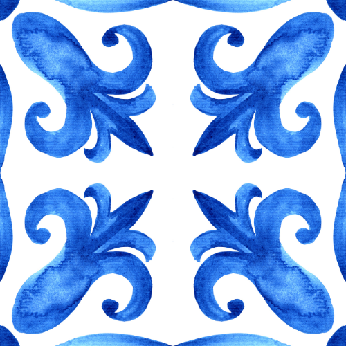
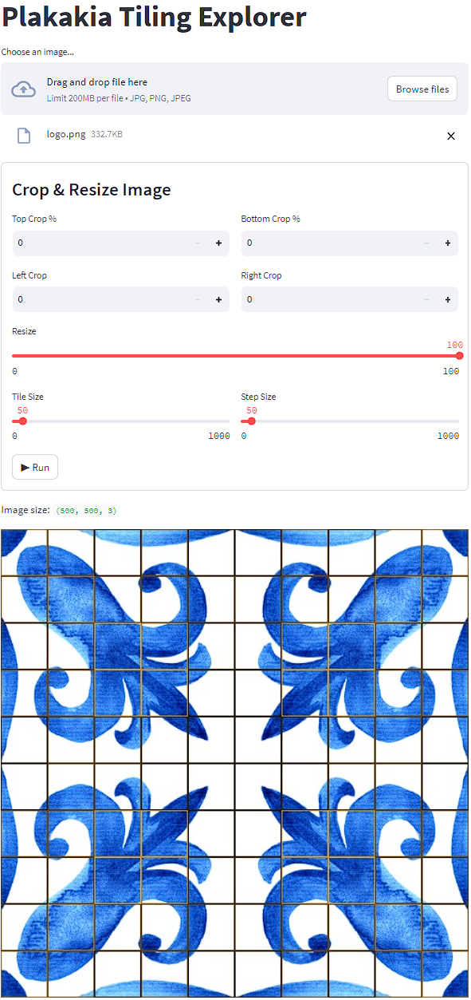

<p align="center">
  
</p>

<h1 align="center">plakakia</h1>

<p align="center"><em>πλακάκια: fast image tiling for computer vision datasets</em></p>

<p align="center">
  <a href="https://pypi.org/project/plakakia/"></a>
  <a href="https://pypi.org/project/plakakia/"></a>
  <a href="https://github.com/kalfasyan/plakakia/actions/workflows/ci.yml"></a>
  <a href="https://kalfasyan.github.io/plakakia"></a>
  <a href="https://github.com/astral-sh/ruff"></a>
  <a href="LICENSE"></a>
</p>

**plakakia** splits images into (overlapping) square tiles and carries their labels along:
bounding boxes in **YOLO**, **Pascal VOC** or **COCO** format, or **segmentation masks**.
Use it to train and run detectors on large images (aerial, satellite, microscopy, inspection)
at full resolution.

- **Fast**: vectorised NumPy tiling and box assignment, plus a multiprocess pipeline.
- **Small**: four dependencies (`numpy`, `opencv-python-headless`, `pyyaml`, `tqdm`).
- **Any image**: grayscale, RGB(A), 16-bit, or arrays with any number of channels.
- **Typed and tested**: strict mypy, full test suite on Linux, macOS and Windows.

## Installation

```bash
uv add plakakia        # or: pip install plakakia
```

Requires Python 3.10+.

## Quick start

### Tile an array (online)

```python
import cv2
from plakakia import tile_image

image = cv2.imread("scene.jpg")
tiles, coords = tile_image(image, tile_size=640, step_size=480, cover_edges=True)
# tiles:  (N, 640, 640, 3) array
# coords: (N, 4) array of (x1, y1, x2, y2), so tiles[i] == image[y1:y2, x1:x2]
```

With boxes:

```python
from plakakia import assign_boxes_to_tiles, clip_boxes_to_tile, read_yolo

ann = read_yolo("scene.txt", image_size=image.shape[:2])
assignment = assign_boxes_to_tiles(ann.boxes, coords, min_visibility=0.6)  # (tiles, boxes) bool

for t in range(len(tiles)):
    idx = assignment[t].nonzero()[0]
    boxes, labels = clip_boxes_to_tile(ann.boxes[idx], coords[t]), ann.labels[idx]
```

### Tile a dataset (offline)

```bash
plakakia --config config.yaml
```

```yaml
input_dir_images: data/images
input_dir_annotations: data/labels
input_format_annotations: yolo   # yolo | pascal_voc | coco | segmentation | none
output_format_annotations: yolo  # yolo | pascal_voc
tile_size: 640
step_size: 480
cover_edges: true
num_workers: -1                  # all cores
```

See [`examples/config.yaml`](examples/config.yaml) for every option and the
[CLI documentation](https://kalfasyan.github.io/plakakia/cli/) for details. Or use it from
Python:

```python
from plakakia import TilingConfig, run

results = run(TilingConfig.from_yaml("config.yaml"))
```

### Demo app

```bash
uv run --extra demo streamlit run demo/app.py
```



## Features

| | |
| --- | --- |
| Input labels | YOLO (boxes and polygons), Pascal VOC, COCO, PNG masks, or none |
| Output labels | YOLO, Pascal VOC, PNG mask tiles |
| Overlap | any `step_size` ≤ or > `tile_size` |
| Edge handling | `cover_edges` adds border-aligned tiles; `pad_image` pads first |
| Partial boxes | `min_visibility` keeps and clips partially visible boxes |
| Deduplication | `clear_duplicates` keeps the fewest tiles that still contain every box |
| Background tiles | `save_empty_tiles` |

## Benchmarks

Measured with [`benchmarks/bench_pipeline.py`](benchmarks/bench_pipeline.py)
(100 synthetic 1024×1024 JPEG images, 20 boxes each, tile 256, step 128, 4-core VM):

| | 1 worker | 4 workers |
| --- | --- | --- |
| Offline pipeline (images/s) | 24 | 66 |

The pipeline is bound by JPEG decoding and encoding (about 80% of the run time).
`tile_image` on a 4096×4096 RGB image with 961 overlapping tiles takes about 48 ms.

Results from earlier versions on public datasets
(AMD Ryzen 5 PRO 6650U, 6 cores):

| Dataset | Format | Images | tile / step | Tiles | Time |
| --- | --- | --- | --- | --- | --- |
| [Solar Panels v2](https://universe.roboflow.com/roboflow-100/solar-panels-taxvb/dataset/2) | jpg/COCO | 112 | 150 / 50 | 3,075 | 1.1 s |
| [Traffic Signs](https://www.kaggle.com/datasets/valentynsichkar/traffic-signs-dataset-in-yolo-format) | jpg/YOLO | 741 | 300 / 200 | 1,695 | 2.8 s |
| [Hard Hat Workers v2](https://public.roboflow.com/object-detection/hard-hat-workers/2) | jpg/YOLO | 5,269 | 100 / 50 | 21,678 | 6.9 s |
| [MS COCO subset](https://public.roboflow.com/object-detection/microsoft-coco-subset) | jpg/YOLO | 121,408 | 200 / 150 | 177,039 | 3 min 4 s |

## Roadmap

- [x] YOLO, Pascal VOC, COCO and segmentation inputs
- [x] Partially visible boxes (`min_visibility`)
- [x] Full image coverage (`cover_edges`)
- [ ] COCO output
- [ ] Rectangular tiles
- [ ] Multi-channel (e.g. hyperspectral, `.npy`/HDF5) inputs in the offline pipeline
- [ ] Stitching predictions back to full-image coordinates (with NMS)

## Contributing

Contributions are welcome. See [CONTRIBUTING.md](CONTRIBUTING.md) for the uv-based
development setup.

## License

[GPL-3.0-or-later](LICENSE)
