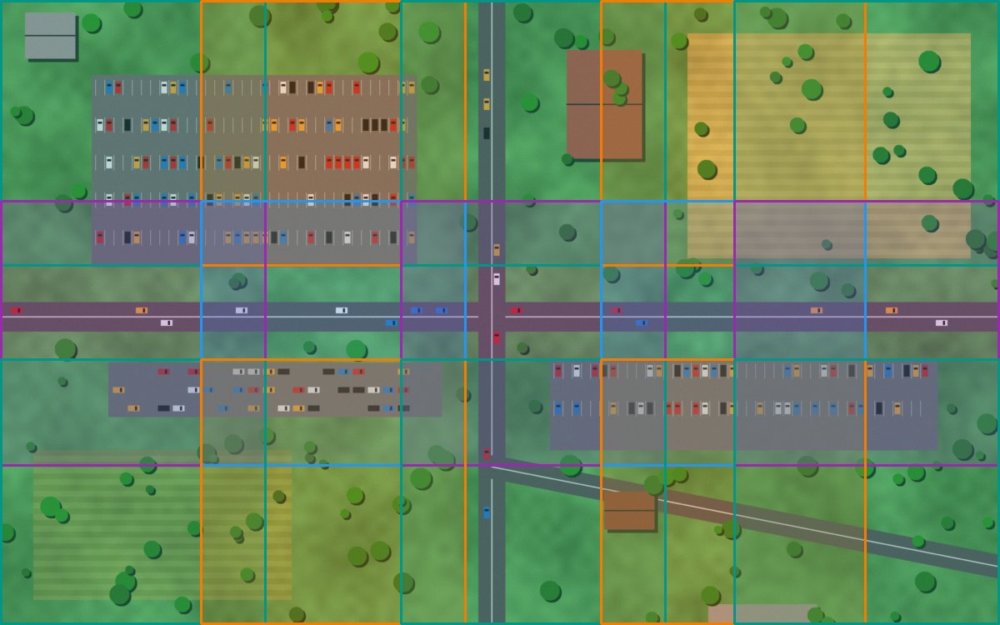
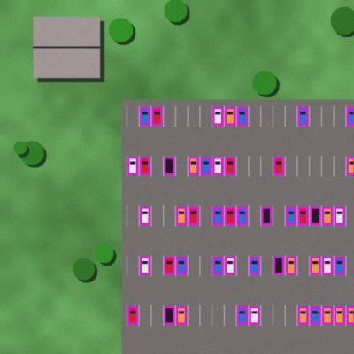
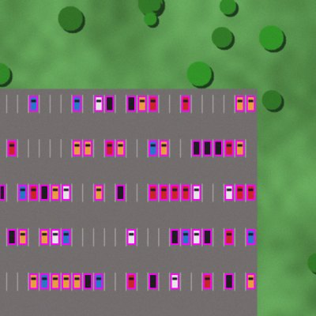
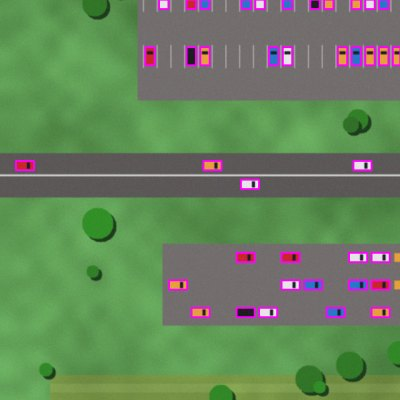

# Getting started

This page takes you from zero to a folder of tiles in about five minutes. You need
Python 3.10 or newer.

## 1. Install

=== "uv"

    ```bash
    uv add plakakia
    ```

=== "pip"

    ```bash
    pip install plakakia
    ```

=== "With hyperspectral and GeoTIFF support"

    ```bash
    uv add "plakakia[hyperspectral,geo]"   # or: pip install "plakakia[hyperspectral,geo]"
    ```

!!! tip "OpenCV windows"
    plakakia depends on `opencv-python-headless`, which has no GUI. If you want
    `cv2.imshow`, also install `opencv-python` in the same environment.

## 2. Tile one image

Any NumPy array works: an image read with OpenCV, Pillow or anything else.

```python
import cv2
from plakakia import tile_image

image = cv2.imread("aerial.jpg")  # shape (1500, 2400, 3)
tiles, coords = tile_image(
    image,
    tile_size=640,  # each tile is 640 x 640 pixels
    step_size=480,  # move 480 px between tiles, so neighbours overlap by 160 px
    cover_edges=True,  # add tiles at the right and bottom borders, so no pixel is lost
)
```

You get back two arrays:

| Name | Shape | What it holds |
| --- | --- | --- |
| `tiles` | `(15, 640, 640, 3)` | The tiles, stacked like a batch. |
| `coords` | `(15, 4)` | Where each tile came from: `(x1, y1, x2, y2)` in the image. |

<figure class="plk-fig" markdown>
{ .plk-rounded }
<figcaption>The 15 tiles from the code above, drawn on the input image. Darker bands are
where neighbouring tiles overlap.</figcaption>
</figure>

`tiles[i]` is exactly `image[y1:y2, x1:x2]` for `coords[i]`. Loop over them to run a model,
save them, or look at them:

```python
for tile, (x1, y1, x2, y2) in zip(tiles, coords):
    cv2.imwrite(f"tile_{x1}_{y1}.jpg", tile)
```

!!! question "What should `tile_size` and `step_size` be?"
    Use your model's input size as `tile_size` (640 for most YOLO models). Set
    `step_size` to 70 to 80% of it, so that an object cut by one tile border is whole in
    the neighbouring tile. Try it in the [playground](concepts.md#try-it).

## 3. Bring the labels along

If the image has bounding boxes, plakakia tells you which boxes fall in which tile and
converts them to tile coordinates:

```python
from plakakia import assign_boxes_to_tiles, clip_boxes_to_tile, read_yolo

ann = read_yolo("aerial.txt", image_size=image.shape[:2])  # boxes in pixels
inside = assign_boxes_to_tiles(ann.boxes, coords, min_visibility=0.6)

for t, tile in enumerate(tiles):
    keep = inside[t]  # boxes in tile t
    boxes = clip_boxes_to_tile(ann.boxes[keep], coords[t])  # now relative to the tile
    labels = ann.labels[keep]
```

<div class="plk-mosaic" markdown style="max-width: 560px; margin: 1rem auto;">



</div>

`min_visibility=0.6` keeps a car in a tile if at least 60% of it is inside.
[How tiling works](concepts.md#boxes-at-the-tile-border) shows what that means.

## 4. Tile a whole dataset

For a folder of images and labels, you do not need to write any Python. Describe the job
in a YAML file:

```yaml title="config.yaml"
input_dir_images: data/images
input_dir_annotations: data/labels
input_format_annotations: yolo   # yolo | pascal_voc | coco | segmentation | none
tile_size: 640
step_size: 480
cover_edges: true
num_workers: -1                  # use every CPU core
```

and run:

```bash
plakakia --config config.yaml
```

The tiles land in `output/images` and their labels in `output/annotations`, ready for
training. See [Offline tiling](cli.md) for every option.

## 5. Large files and streaming

`tile_image` copies the tiles into a new array. For very large images, ask for the
window positions only and slice them yourself. Slices are views, so nothing is copied:

```python
from plakakia import tile_coordinates

for x1, y1, x2, y2 in tile_coordinates(*image.shape[:2], tile_size=640, step_size=480):
    window = image[y1:y2, x1:x2]
```

For files larger than memory, see [`iter_tiles`](remote-sensing.md#choosing-the-axes).

## Try it without code

The interactive demo lets you upload an image and watch it being tiled:

```bash
uv run --extra demo streamlit run demo/app.py
```

## Next steps

<div class="grid cards" markdown>

-   :material-grid: **[How tiling works](concepts.md)**

    Every setting explained with a picture, plus an interactive playground.

-   :material-console: **[Offline tiling (CLI)](cli.md)**

    Tile a dataset with labels in one command.

-   :material-satellite-variant: **[Hyperspectral & geospatial](remote-sensing.md)**

    Cubes, bands and GeoTIFFs.

-   :material-api: **[API reference](api/tiling.md)**

    Every function and option.

</div>
