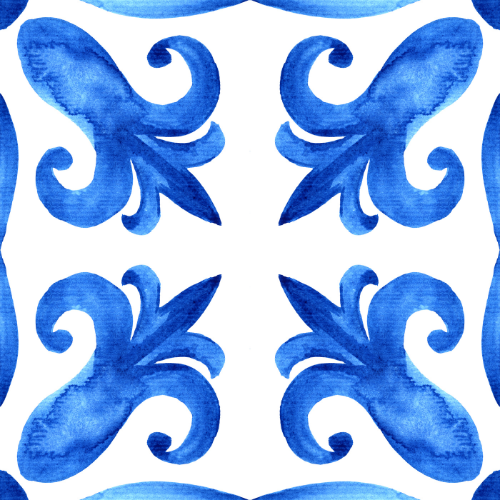
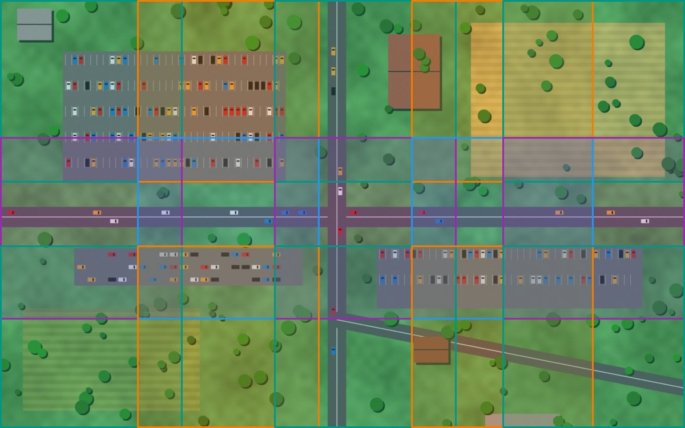
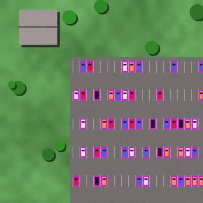
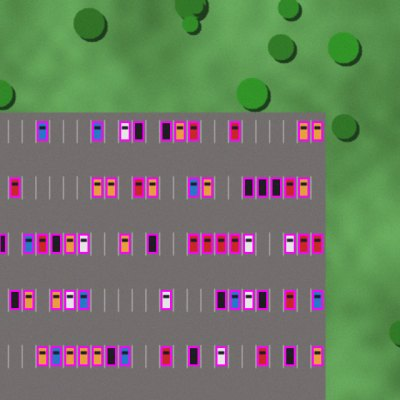
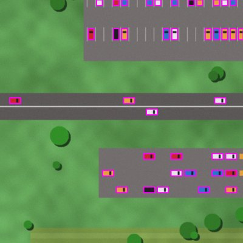
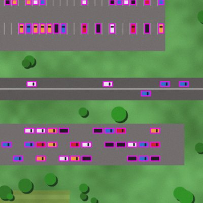
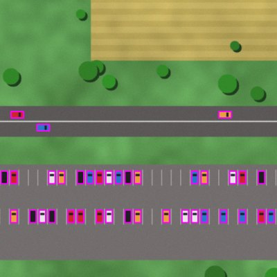
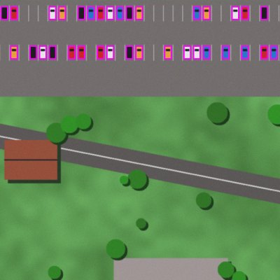
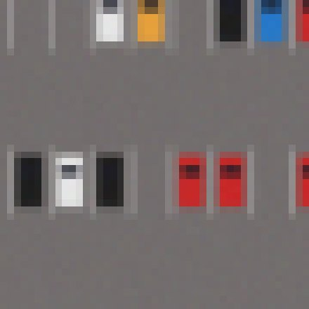
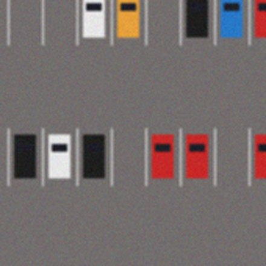

---
hide:
  - navigation
  - toc
---

<div class="plk-hero" markdown>

{ .plk-logo }

# plakakia

<p class="plk-tagline">Cut big images into model-sized tiles, and bring the labels along.<br>
<em>πλακάκια, Greek for "tiles"</em></p>

[Get started in 5 minutes :material-rocket-launch:](getting-started.md){ .md-button .md-button--primary }
[See how tiling works :material-grid:](concepts.md){ .md-button }

</div>

## Big image in, model-ready tiles out

Object detectors and segmentation models expect small inputs, often 640 × 640 pixels.
Aerial photos, satellite scenes, microscopy slides and factory inspection images are much
bigger. plakakia slides a window over the image, cuts it into **tiles**, and moves every
**bounding box** or **mask** into the tile it belongs to.

<div class="plk-flow" markdown>
<figure markdown>
{ .plk-rounded }
<figcaption>One 2400 × 1500 aerial image with 194 labelled cars, cut into 15 overlapping
640 × 640 tiles (<code>step_size=480</code>, <code>cover_edges=True</code>).</figcaption>
</figure>
<div class="plk-arrow">➜</div>
<figure markdown>
<div class="plk-mosaic" markdown>






</div>
<figcaption>Tiles at full resolution, each with its own label file. Boxes are shifted
into tile coordinates and clipped at the border.</figcaption>
</figure>
</div>

## Why not just resize the image?

Shrinking a 2400-pixel image to 640 pixels makes it 3.75 times smaller. A car that was
14 pixels wide becomes 4 pixels wide, and there is little left for a model to learn from.
Tiling keeps every pixel.

<div class="plk-compare" markdown>
<figure markdown>

<figcaption>❌ <b>Resized</b> to 640 px: the cars are a few pixels each.</figcaption>
</figure>
<figure markdown>

<figcaption>✅ <b>Tiled</b> at native resolution: every detail is kept.</figcaption>
</figure>
</div>

## Three lines of Python

```python
import cv2
from plakakia import tile_image

image = cv2.imread("aerial.jpg")  # (1500, 2400, 3)
tiles, coords = tile_image(image, tile_size=640, step_size=480, cover_edges=True)
tiles.shape  # (15, 640, 640, 3): a batch, ready for your model
coords[0]  # [0, 0, 640, 640]: (x1, y1, x2, y2) of tile 0 in the image
```

Or tile a whole labelled dataset, on every CPU core, with one command:

```bash
plakakia --config config.yaml
```

## What you get

<div class="grid cards" markdown>

-   :material-tag-multiple:{ .lg .middle } **Labels come along**

    ---

    Bounding boxes in **YOLO**, **Pascal VOC** or **COCO**, and **segmentation masks**,
    are cut with the image. Choose how much of an object must be visible to keep it.

    [:octicons-arrow-right-24: Boxes and tiles](concepts.md#boxes-at-the-tile-border)

-   :material-lightning-bolt:{ .lg .middle } **Fast and small**

    ---

    Vectorised NumPy with no Python loop over tiles, and a multiprocess pipeline. Only
    four dependencies: `numpy`, `opencv-python-headless`, `pyyaml`, `tqdm`.

    [:octicons-arrow-right-24: Offline tiling](cli.md)

-   :material-cube-outline:{ .lg .middle } **Any image, any axes**

    ---

    Grayscale, RGB(A), 16-bit, multispectral and hyperspectral cubes, channels-first or
    last. Tile along the spatial axes, the spectral axis, or both.

    [:octicons-arrow-right-24: Hyperspectral data](remote-sensing.md)

-   :material-earth:{ .lg .middle } **Maps stay maps**

    ---

    Satellite and drone GeoTIFF tiles keep their coordinate system, so they open in
    QGIS exactly where they belong. Mostly empty tiles can be skipped.

    [:octicons-arrow-right-24: Geospatial data](remote-sensing.md#satellite-and-drone-imagery-geotiff)

-   :material-gesture-tap:{ .lg .middle } **See it before you run it**

    ---

    Drag a slider and watch the grid change in the browser, or upload your own image
    to the Streamlit demo.

    [:octicons-arrow-right-24: Tiling playground](concepts.md#try-it)

-   :material-shield-check:{ .lg .middle } **Typed and tested**

    ---

    Fully type-annotated (`py.typed`, strict mypy) and tested on Linux, macOS and
    Windows, Python 3.10 to 3.13.

    [:octicons-arrow-right-24: API reference](api/tiling.md)

</div>

## Where it helps

| Field | Typical image | What plakakia does |
| --- | --- | --- |
| :material-airplane: Drones and aerial survey | 6000 × 4000 photos, tiny objects | Tiles plus YOLO labels for detector training |
| :material-satellite-variant: Satellite imagery | Multi-band GeoTIFF scenes | Georeferenced tiles, nodata filtering |
| :material-microscope: Microscopy and pathology | Gigapixel slides, cell masks | Memory-mapped tiling, mask tiles |
| :material-factory: Industrial inspection | High-resolution line-scan images | Overlapping tiles so no defect is cut in half |
| :material-flask: Hyperspectral imaging | `(H, W, 224 bands)` cubes | Spatial and spectral windows |

New to tiling? Start with [**How tiling works**](concepts.md): it explains every idea with
a picture and lets you play with the settings.
