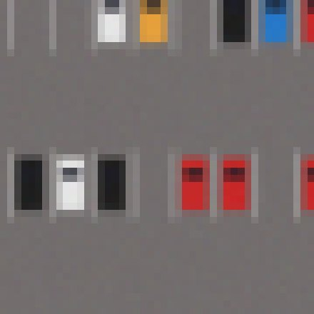
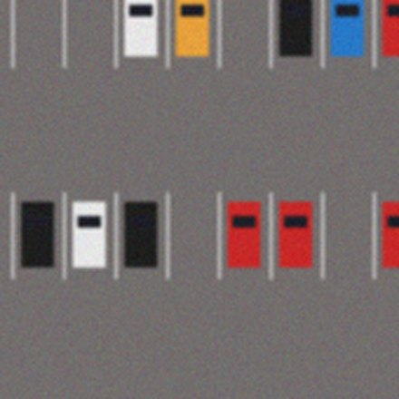

# Small object detection

Insects on a sticky trap, cells on a microscope slide, cars in a satellite scene, cracks on a
wind turbine blade: these objects are often only 10 to 30 pixels wide in an image that is
thousands of pixels wide. Most detectors resize their input to about 640 pixels, and at that
size the objects all but disappear.

<div class="plk-compare" markdown>
<figure markdown>

<figcaption>❌ The whole image resized to 640 px: each car is a few pixels.</figcaption>
</figure>
<figure markdown>

<figcaption>✅ A 640 px tile at native resolution: every car is clear.</figcaption>
</figure>
</div>

The fix is to **never shrink the image**: train on tiles, run the model on tiles, then put
the detections back on the full image. plakakia does every step, with any model:
training tiles come from one command, and prediction plus merging is one function call.

```text
1. Train     big images + labels ──► plakakia ──► tiles + labels ──► train
2. Predict   big image ──► predict_tiled(image, model) ──► boxes on the full image
               (tiles in batches ► your model ► shift by tile offsets ► merge duplicates)
```

## 1. Train on tiles

Tile your labelled dataset once, then train any detector on the tiles as if they were
normal images.

```yaml title="config.yaml"
input_dir_images: data/images
input_dir_annotations: data/labels
input_format_annotations: yolo
tile_size: 640          # your model's input size
step_size: 480          # 25% overlap: objects cut by a border are whole next door
cover_edges: true
min_visibility: 0.6     # keep objects at least 60% inside a tile
save_empty_tiles: true  # background tiles: what is *not* an object
num_workers: -1
```

```bash
plakakia --config config.yaml
```

!!! tip "Choosing the tile size"
    Use the input size of your model, so tiles are not resized again during training.
    Objects should be well under half the tile; if some objects are larger than that,
    also train on downscaled full images, or use a bigger tile.

## 2. Predict and merge in one call

At inference time, `predict_tiled` cuts the image with the **same** `tile_size`, runs your
model on batches of tiles, moves every box from tile to image coordinates and removes
the duplicates. You only tell it how to call your model: a function that takes a batch of
tiles and returns `(boxes, scores, class_ids)` for each tile, in tile pixels.

=== "Ultralytics YOLO"

    ```python
    import cv2
    from ultralytics import YOLO

    from plakakia import predict_tiled

    yolo = YOLO("trained_on_tiles.pt")


    def model(tiles):
        results = yolo.predict(list(tiles), imgsz=640, conf=0.25, verbose=False)
        return [(r.boxes.xyxy, r.boxes.conf, r.boxes.cls) for r in results]


    image = cv2.imread("trap_042.jpg")
    dets = predict_tiled(image, model, tile_size=640)
    dets.boxes, dets.scores, dets.class_ids  # (N, 4), (N,), (N,) on the full image
    ```

=== "PyTorch"

    ```python
    import torch

    from plakakia import predict_tiled

    net = torch.load("detector.pt").eval().cuda()
    image = torch.from_numpy(rgb).permute(2, 0, 1).float().cuda() / 255  # (3, H, W)


    @torch.no_grad()
    def model(tiles):  # tiles: (B, 3, 640, 640), already on the GPU
        return [(o["boxes"], o["scores"], o["labels"]) for o in net(tiles)]


    dets = predict_tiled(image, model, tile_size=640, axes=(1, 2), batch_size=32)
    ```

=== "Any model"

    ```python
    import cv2

    from plakakia import predict_tiled

    image = cv2.imread("trap_042.jpg")
    # my_detector(tile) -> (boxes (N, 4) x1 y1 x2 y2, scores (N,), class_ids (N,))
    dets = predict_tiled(image, lambda tiles: [my_detector(t) for t in tiles], tile_size=640)
    ```

The tiles keep the type of the image: a NumPy image gives NumPy batches, and a PyTorch or
CuPy tensor on a GPU gives batches on that GPU. Your model may return NumPy arrays,
tensors on any device, or lists.

### What the merge does

* **Offsets.** Each tile's boxes are moved by the tile's top-left corner, so they are in
  full-image pixels.
* **Duplicates.** An object in the overlap of two tiles is found twice. Non-maximum
  suppression (NMS), per class, keeps the best box of each group that overlaps by more
  than `iou_threshold` (0.5).
* **Cut objects.** An object on a tile border is only partly visible in that tile, so its
  box there is cut off, and too small to look like a duplicate of the full box from the
  neighbouring tile. `predict_tiled` knows which boxes touch an inner tile border: it
  fuses them with the box that contains them, and joins the parts of an object that
  meet at a border into one box (even without overlap). Turn this off with
  `fuse_seams=False`.

| Option | Default | Use it to |
| --- | --- | --- |
| `step_size` | 80% of `tile_size` | set the overlap |
| `batch_size` | 16 | fit your GPU memory |
| `score_threshold` | 0 | drop weak boxes before merging |
| `iou_threshold` | 0.5 | merge more (lower) or fewer (higher) boxes |
| `class_agnostic` | `False` | merge overlapping boxes of different classes |
| `full_image` | `False` | also find objects larger than a tile (below) |

Building your own pipeline? `tile_batches` yields the batches with their coordinates,
and `merge_detections` merges boxes you already have.

!!! tip "Objects larger than a tile"
    Pass `full_image=True`: the model also runs once on the whole image, downscaled to
    `tile_size`. Large objects are found there and small ones in the tiles, and the
    two are merged together.

## On maps

For satellite and drone imagery, read the scene with `plakakia.io.read_geotiff` and pass
its profile along. The detections then know where they are on Earth, and go straight
into QGIS or any GIS as GeoJSON:

```python
import json

from plakakia import predict_tiled
from plakakia.io import read_geotiff

scene, profile = read_geotiff("orthomosaic.tif")  # (bands, H, W)
dets = predict_tiled(scene, model, tile_size=640, axes=(1, 2), profile=profile)

geojson = dets.to_geojson(class_names=["car", "truck"])  # polygons in the scene's CRS
with open("detections.geojson", "w") as f:
    json.dump(geojson, f)
```

Each feature is a box polygon in map coordinates with its `score`, `class_id` and
`class_name`. `dets.map_polygons()` gives the same corners as an array. See
[Hyperspectral & geospatial](remote-sensing.md) for tiling GeoTIFFs.

## Checklist

* Same `tile_size` for training and inference.
* 20 to 30% overlap (`step_size` = 0.7 to 0.8 × `tile_size`).
* `cover_edges: true`, so objects at the image border are not missed.
* Some empty tiles in the training set (`save_empty_tiles`).
* `predict_tiled` with the same `tile_size`, and `full_image=True` if some objects are large.
